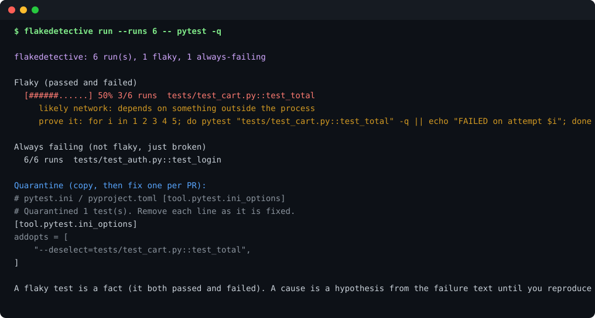

# flakedetective

**Find out which tests are flaky, what the evidence suggests, and exactly how to prove it.** Local, no account, no test-suite rewrite.

[](https://github.com/mgkvibez/flakedetective/actions/workflows/ci.yml)
[](LICENSE)
[](pyproject.toml)



## Install

```bash
pipx install git+https://github.com/mgkvibez/flakedetective.git
```

## Use it

```bash
# run the suite 20 times and get a ranked verdict
flakedetective run --runs 20 -- pytest -q

# same for a JS project (auto-detects jest output)
flakedetective run --runs 15 -- npm test

# print a quarantine snippet you can paste into pyproject.toml
flakedetective quarantine --min-score 0.3
```

Exit codes are part of the contract: `0` nothing flaky, `3` flaky tests found, `2` bad usage. Gate CI on `3` without parsing text.

## Why it exists

A flaky test is worse than a failing one: the failure tells you nothing, so you re-run, then you start ignoring the suite. Most teams know *that* something is flaky, not *which* test or *why*. This runs your suite a number of times, counts real observations, and separates three states that get conflated:

- **flaky** — it both passed and failed,
- **broken** — it failed every time (not flaky, just broken: fix it),
- **stable** — never failed.

Only the first one deserves the word.

## How it works

1. **Run** your existing command N times, capturing both streams. No plugins, no fixtures, no changes to your suite.
2. **Parse** failures into per-test observations. Shipped parsers: pytest, jest, unittest. `--parser` overrides auto-detection.
3. **Cluster** by test id, so a test that failed 3 of 20 runs is one row with a 15% score, not three log lines.
4. **Hypothesise** a cause from the failure text (network, timeout, shared state, randomness, concurrency, filesystem) and attach the number of runs supporting it.
5. **Prove it**: every flaky test gets a copy-pasteable repro loop, and you get a quarantine snippet so the suite goes green while you fix things one at a time.

Honest limits, because they matter:

- A cause is a **hypothesis** from the failure text until you reproduce it. The report says so on every run.
- pytest can deselect an individual test, so its snippet is exact. **Jest has no per-test config**, so its snippet scopes the ignore to files and marks the tests to skip in place.
- Runs are serial. A test that only flakes under parallel execution needs `-n auto` inside your own command.

The ledger (`.flakedetective/runs.jsonl`) is append-only, so `flakedetective analyze` can re-read history without re-running anything. CI can collect runs on a schedule and analyze them later.

## Contributing

Open an issue before a PR. Adding a harness is one function plus one fixture in `tests/` (see `flakedetective/parsers.py` and the `PARSERS` table); keep it dependency-free and add a test that fails without your parser.

Run the gate before pushing:

```bash
bash scripts/verify.sh
```

It runs four checks: install, version consistency, the suite, and a CLI smoke that asserts the documented exit code.

## License

MIT.
